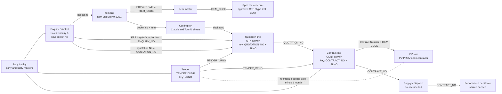

# Interconnection map (for Puja's sign-off)

Guideline section 9.1 item 10, dated 27 Nov 2026. It shows which records exist, the real identifiers that join them, and which page uses which link. The keys were checked against the synced data on 27 Nov 2026.

## 1. Records and keys

## 2. Link table

| From | To | Join on | Checked in data | Confidence |
|---|---|---|---|---|
| Enquiry | Item line | docket no | yes, same key in both Smartsheets | real key |
| Enquiry | Quotation line | `ERP Inquiry Voucher No` = `ENQUIRY_NO` (example E226N26-006) | yes | real key |
| Enquiry | Quotation line | `Quotation No.` = `QUOTATION_NO` (example LQ26Y-01194) | yes | real key |
| Quotation line | Contract line | `QUOTATION_NO` (+ `QUOTATION_SLNO` for the line) | yes | real key |
| Tender | Quotation line | `VRNO` = `TENDER_VRNO` | filled on 7,426 of 92,886 quotation lines | real key where filled |
| Tender | Contract line | `VRNO` = `TENDER_VRNO` | filled on 1,532 of 7,229 contract lines | real key where filled |
| Tenders app record | Enquiry | `Docket No` (format ENQ-nnnnn-yy-yy), held on both | key exists on both sides (guideline 9.16); not yet readable until Bidyut extends the app's data link | real key |
| Tenders app record | ERP tender (TENDER DUMP) | `Reference No` = `TENDER REFNO` | same format seen on both (for example GEM/2026/B/8258770) | real key where filled |
| Tenders app record | Contract | `Contract No`, LOI / PO number | fields exist in the Tenders app | real key where filled |
| ERP tender (TENDER DUMP) | Enquiry | tender reference / bid number and utility | no shared key | **matched by reference**, lower confidence, a person confirms. Use the Tenders app link above first |
| Item line | Item master | code after "@" in `PROPOSE ERP ITEM NAME @ CODE` = `Item Code` | yes | real key |
| Item master | Quotation / contract line | `ITEM_CODE` | yes | real key |
| Item | Type test | `ERP Code` | yes | real key |
| Item | Pre-approved GTP | `ITEM CODE` (+ `Utility`) | yes | real key |
| Item | Spec master | `PROPOSE ERP ITEM NAME @ CODE` (+ `Utility`) | yes | real key |
| Item line | BOM | `ACTUAL NON CHAIN BOM ID` = `BOM Code` | yes | real key |
| Contract | PV row | `CONTRACT_NO` = `Contract Number`, with `ITEM CODE` | yes | real key |
| Contract | Supply, performance certificate | `CONTRACT_NO` | source not connected | pending |
| Party / utility | everything | party code / utility code where the record has one, else name | codes in the dumps (`CUSTOMER CODE`, `UTILITY CODE`, `ACC_CODE`); names in Smartsheet | **matched by name** between Smartsheet and ERP dumps |

Three links need attention:
1. **Tender to enquiry.** The Tenders app carries the docket number, so a tender handled there links to its enquiry by a real key. The ERP tender dump has no docket number; it reaches the enquiry through the Tenders app (by reference number), and only failing that by reference and utility, marked "matched by reference".
2. **`TENDER_VRNO` is blank on most contract lines** (about four in five). Where it is blank the tender is reached through the quotation, then by reference. This matters for the PV base-date lookup (guideline 8.1).
3. **Party names in Smartsheet and customer codes in ERP** are joined by name until a party code is held on the enquiry.

## 3. Which page views which record

Pages are views of the records above. A page does not repeat another page's table; it links to it.

| Group | Page (Power BI no.) | Records viewed | Links out | Linked from |
|---|---|---|---|---|
| Enquiry | Home (1) | funnel and exception counts over the whole chain | docket 360 | all |
| Enquiry | New enquiries | enquiries created in the dashboard | docket 360 | Home |
| Enquiry | Item wise breakup (2) | item lines | docket, item, quotation | Home, docket |
| Enquiry | No ERP code (13) | item lines without a code | docket, item proposal | Home exception |
| Quotation and Cost | Quotation history (3) | quotations | docket, contract, costing | docket, item, party |
| Quotation and Cost | Auto quotation (10), Cost calculation sheet (11), Cost calculation tender & budgetary (22) | costing runs and lines | docket, item, rate chart, BOM | docket, quotation |
| Quotation and Cost | Quotation export and review (18) | costing reviews | docket, costing sheet | docket |
| Quotation and Cost | Today's rate chart (12) | RM rates | costing lines using the rate | costing |
| Masters | BOM master (4), BOM master quad (7) | BOMs | item, costing | item, costing |
| Masters | GTP master (5), CSD master (6), DD master (14) | GTP / CSD / drum standards | item, docket task | docket, item |
| Masters | Item master, Specification master | items, specs | quotations, contracts, type test, GTP for the item | every item code |
| Attachments and Approvals | Type test (9) | type test certificates | item | item, docket |
| Attachments and Approvals | Pre-approved GTP (15) | approved GTPs | item, contract | item, docket |
| Attachments and Approvals | Attachment of costing sheet (16) | Claude's and Touhid's costing files | docket | docket, quotation |
| Attachments and Approvals | Board attachment (19) | board approvals | docket / contract | docket |
| Supply and Performance | Supply history (8), for sale bill (17) | supplies against contracts | contract, item, party | contract, party |
| Supply and Performance | Performance history (20, 21) | performance certificates | contract, party | contract |
| PV | PV | PV rows, base date, indices | contract, tender | contract |
| Contract Execution | Sales contract; CONT EX 2 pages: Home, Lot review, Pending order, TVA, RM req against balance MC | contracts, lots, MC and delivery status, raw material need | docket 360, costing and PV tabs, delivery location, submissions | contract, Home control views |
| (Tenders app, port 3126) | its own pages: Pre / Post / Not Participated, Quotation Pending, Supply History, Performance Certificates, EMD Merged | tender decisions, dates, EMD, results | opened by link from the docket; not rebuilt here | docket, tender |
| Reports | ERP tenders, quotation lines, contract lines | the raw dumps | each other through the keys above | every tender / quotation / contract number |

## 4. The docket 360° view

One page per docket, built from links, not copies: lifecycle strip (tender → enquiry → items → spec/GTP/type test/BOM → costing → quotation → contract → PV → supply → certificate, each with date, owner, status), then sections for mail and attachments, items and ERP codes, costing sheets and review state, quotations and revisions, contract, PV, supply and comments.

## 5. Sign-off

Please confirm: (a) the keys in section 2, (b) that "matched by reference / by name" links may be shown with a lower-confidence mark, (c) the page grouping in section 3.
